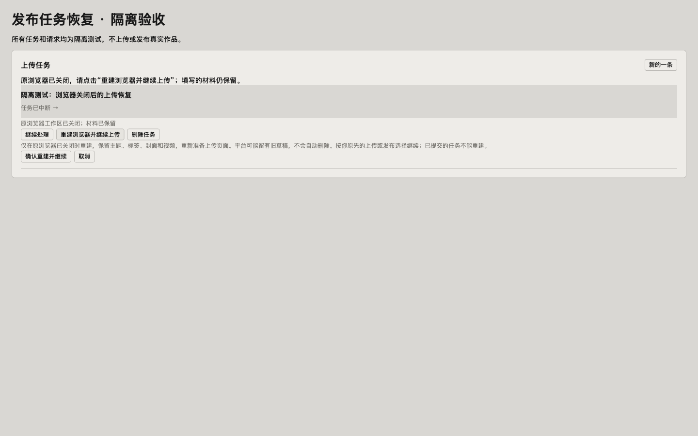
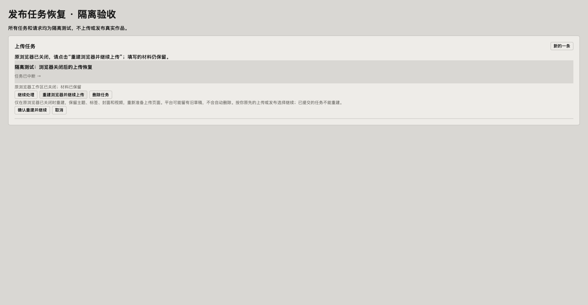

# 发布任务浏览器关闭后的恢复 · 2026-10-29

## 已确认原因

当前任务仍登记浏览器工作区34。Ego工作区清单无34，直接读取返回 `task space not found: 34`。继续处理原先只是重启后台进程，保留失效空间编号；顶栏上传又因已有任务而禁用，形成恢复闭环。记录显示小红书到填写文案阶段，其他平台未完成；不是整条作品均未开始，也没有据此推断已发布。

## 修复

- 本人点继续时，先检查身份并接回原浏览器，保留页面和上传检查点。已关闭则说明重建入口，不启动无效进程。
- 上传任务增加“重建浏览器并继续上传”：确认后后台再次检查原空间确实不存在，保留作品、素材、文案、视频哈希及原有上传/发布选择；重新准备丢失的页面，旧审核截图与就绪状态失效。
- 已经进入发布提交、有发布回执或发布失败证据时拒绝重建，不以未知状态重发。原浏览器仍在（包括用户控制）时也拒绝重建，须接回原页面。
- 删除时已不存在的工作区视为清理完成；同编号身份不符不操作。过期版本不能停止正在运行的任务或重复启动。
- 用户确认前说明可能遗留平台私有草稿，本轮不自动清理平台草稿。

## 验证

`npm run format`、完整 `npm run check` 通过：90个测试文件、249项测试通过，附带检查脚本全部通过。

隔离回归覆盖：丢失空间后重建、材料保留/审核失效/旧进程令牌失效、重复请求拒绝、原空间存在不可重建、提交中/审核中/已发布/发布失败/提交授权均不可重传、接回后再启动、原直接发布意图保留且普通上传不升级发布。

Ego使用真实任务列表组件的隔离页面：继续返回明确错误；打开确认后取消不发送重建请求；确认只发送一次 `rebuild-upload`，进入运行状态并显示暂停。结果见 `result.json`。1440/1728截图无横向溢出，复用现有颜色、卡片与按钮。一次等待使用了不支持的裸role选择器，改为读取当前状态继续，未重复触发原动作。

真实发布页只读确认新增按钮和原内容仍在（`live-entry.png`）；本轮没有点击真实任务恢复、重建、上传或发布。平台实际上传成功仍需用户重新执行该任务验证。

