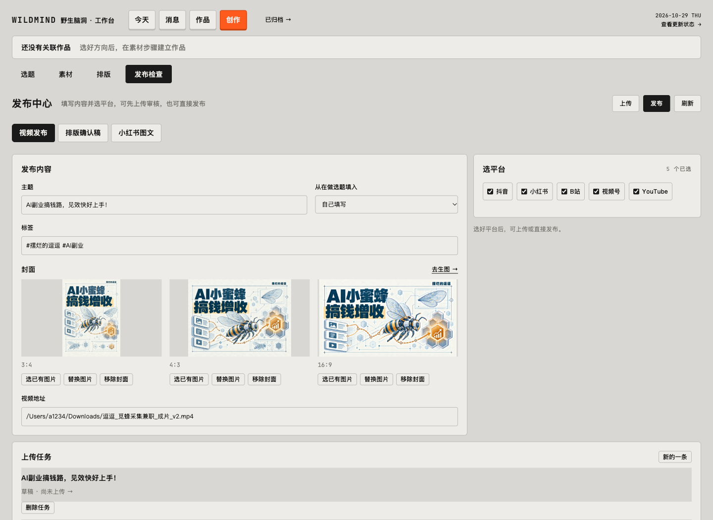
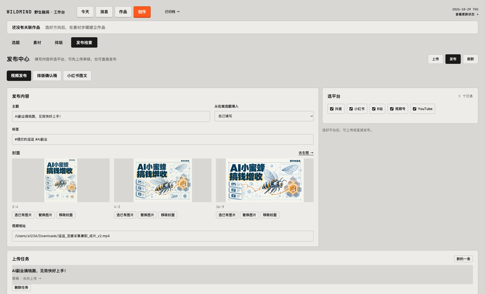

# 上传前封面校验修复 · 2026-10-29

## 原因与修复

用户已保存的 16:9 封面实际为 1672×941，属于配置允许的像素取整误差。页面选图与保存已使用 `matchesCoverRatio`，但 `enqueuePublishingUpload` 仍采用严格交叉相乘，导致准备横版封面时返回 400，尚未创建上传任务。

上传入口改为复用相同配置与判断，仍读取实际图片尺寸，明显错误时返回实际宽高。保留原图，不裁剪。点击上传后立即提示正在检查材料；处理中按钮不再显示等待保存的通用原因。

## 验证

- `npm run format`、`npm run check` 通过，85 个测试文件、224 个测试通过，附带脚本检查全部通过。
- 隔离回归：实际1672×941通过并创建上传任务，且不附带发布授权；素材元信息相同但实际1672×980时拒绝且不启动任务。
- Ego只读打开当前发布页，上传按钮可用，原主题、标签、五平台、封面和视频地址保持。1440/1728截图人工检查，首屏操作可见，无横向溢出。首次导航等待load超时，沿用原页面确认已正常加载。
- 本轮未点击真实上传或发布，未修改真实作品记录。当前草稿是否完成平台上传仍需实际执行验证。

